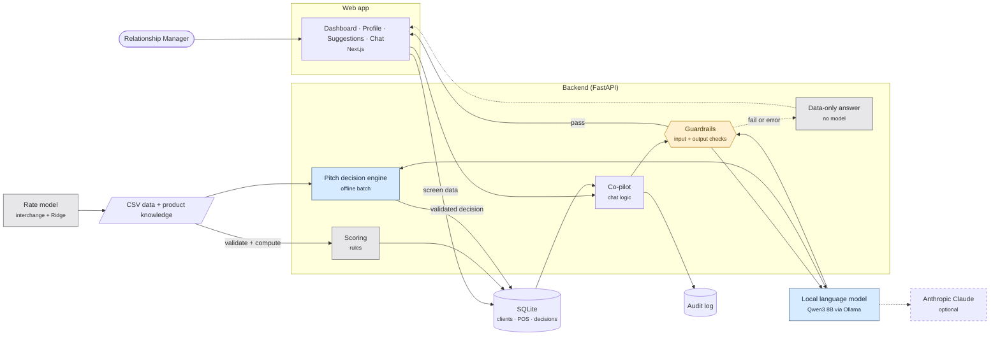
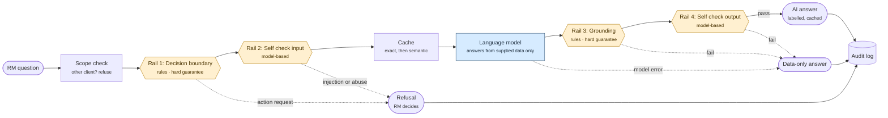
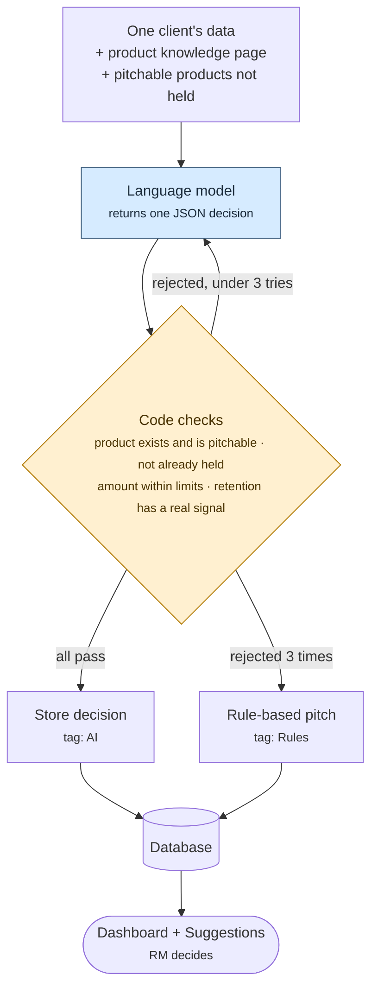

# Brief for an LLM: draw the RM Co-pilot system architecture

Give this whole file to an LLM (Gemini, Claude, ChatGPT) and ask it to produce the diagrams in section 6. Everything in sections 2 to 5 was taken from the project's source code and is the ground truth. Do not add components, products or integrations that are not listed here.

## 1. Your task

Create architecture diagrams of **RM Co-pilot** for a hackathon pitch deck. The audience is judges: a mix of banking executives and technologists. They will see each diagram for 20 to 40 seconds on a slide, so every diagram must be understood at a glance.

**Produce:**

- Diagram A: the one-slide overview (required)
- Diagram B: the chat pipeline with guardrails (required)
- Diagram C: the pitch decision engine (required)
- Diagram D: the data pipeline (optional)
- Diagram E: the AI versus rules map (optional)

**For each diagram, return:**

1. **Mermaid code** that renders in mermaid.live, so it can be exported as SVG or PNG for PowerPoint.
2. A **one-line slide title** that states the takeaway (for example "AI proposes, code verifies, the RM decides"), not a label such as "Architecture".
3. **Three speaker-note bullets** (what to point at, in order).
4. A **plain-English caption** of at most 20 words.

If the user asks for a different tool, give the same content as a draw.io-importable description or as an SVG instead.

## 2. The product in one paragraph

RM Co-pilot is a web app for a bank Relationship Manager (RM) who looks after SME merchant clients that accept card payments on the bank's POS terminals. It ranks which clients need attention, recommends what to offer each client with a reason, and answers questions in a chat. The system recommends and explains; the RM decides and acts. It never approves, sends, changes or books anything. All demo data is synthetic. The default language model runs locally, so client data does not leave the machine.

## 3. Components (the only boxes allowed)

### Users and screens

| Component | Detail |
|---|---|
| Relationship Manager (RM) | The only user. Uses the web app in a browser. |
| Web app | Next.js 15 and React 19 on port 3000. Four screens: Dashboard (Opportunities board and All table), Profile and analytics, Suggestions, Co-pilot chat (portfolio mode and single-merchant mode). |

### Backend (FastAPI, port 8000)

| Component | File | Job |
|---|---|---|
| API layer | `main.py` | 9 endpoints: dashboard, clients, client detail, filters, suggestions, two chat endpoints, data status. Adds a request ID and an audit line to every chat reply. |
| Rate limiter | `ratelimit.py` | 30 chat requests per minute per client address. |
| Readers | `readers.py` | Turn stored data into API responses. `PortfolioReader` serves all clients; `ClientReader` serves exactly one. |
| Co-pilot | `copilot.py` | Builds the chat prompt, runs the scope guard, calls the model, falls back to a data-only answer. |
| Guardrails | `guardrails.py`, `guard_rules.py`, `rails/` | NVIDIA NeMo Guardrails: two input rails and two output rails. |
| Chat cache | `chat_cache.py` | Exact and semantic cache of passing answers (ChromaDB, 24-hour expiry). |
| LLM gateway | `llm.py` | One function that all model calls go through. Switches between the local model and Anthropic Claude by configuration. |
| Pitch decision engine | `suggest_llm.py`, `catalogue.py`, `knowledge.py` | Offline batch. The model decides one pitch per client; code validates it. |
| Scoring | `scoring.py` | Rule-based attention score, RM action and fallback pitch. |
| Ingest | `ingest.py` | Validates the CSV files, computes client facts, writes the database and a data-quality report. |
| Audit log | `audit.py` | Append-only JSON Lines file. |

### Data and models

| Component | Detail |
|---|---|
| Source CSV files | Merchant profiles (150), daily POS acquiring (36,000 rows), products held, new-to-bank cross-sell candidates. |
| Product knowledge page | Built from the product catalogue and two public Emirates NBD documents (packages and charges, business loans). Read by the model. |
| SQLite database | `rm_copilot.db`: 11 tables, including client, pos_daily, client_fact, client_priority, client_suggestion. |
| Audit log file | `audit_log.jsonl`. |
| ChromaDB | Local vector store for the chat cache. Uses a local embedding model. |
| Local language model | Qwen3 8B (`qwen3:8b-rm`, 8K context) served by Ollama on port 11435. |
| Alternative language model | Anthropic Claude, selected by configuration. Drawn as a dashed, optional box. |
| Rate model (offline) | `ml_rate_model.py`: real Visa UAE interchange table plus a Ridge regression for the spread. Its output is written into the merchant CSV before ingest. It does not run inside the app. |

## 4. Connections (the only arrows allowed)

### Online path (when the RM uses the app)

1. RM to Web app.
2. Web app to API layer for screen data. These requests go through the Next.js proxy.
3. Web app to API layer for chat. These requests go directly to port 8000 (cross-origin allowed for localhost:3000).
4. API layer to Rate limiter to Co-pilot (chat only).
5. API layer to Readers to SQLite (all screens).
6. Co-pilot to Guardrails (input rails), then to Chat cache, then to LLM gateway, then to Local language model.
7. Local language model back through Guardrails (output rails) to the Co-pilot.
8. If an output rail fails or the model errors, Co-pilot produces the **data-only answer** from Readers. Draw this as a visible side path, because it is a key safety feature.
9. Co-pilot to Audit log (one line per chat).
10. Passing answers are stored in the Chat cache.

### Offline path (when data is loaded)

1. Rate model reads the merchant and POS CSV files and writes rate columns into the merchant CSV.
2. Source CSV files to Ingest, which validates, quarantines bad rows and computes client facts.
3. Ingest to SQLite and to the data-quality report.
4. Scoring (inside ingest) writes attention scores, flags, actions and the fallback pitch to SQLite.
5. Pitch decision engine reads one client's data plus the Product knowledge page, calls the Local language model, validates the answer in code, and writes the decision to SQLite. On a failed validation after three tries, it writes the rule-based fallback instead.
6. Pitch decision engine to Audit log (one line per decision).

## 5. Facts for the specific diagrams

### Diagram B: the chat pipeline, in order

1. RM question
2. Scope check (single-merchant chat only): a question naming another client is refused before any model call
3. Input rail 1, **Decision boundary** (rules): blocks "approve, send, change, book" requests
4. Input rail 2, **Self check input** (model-based): blocks prompt injection, requests for the system prompt, role-play, code, abuse
5. Cache lookup: exact match, then semantic match
6. Language model answers from the supplied data and knowledge page only
7. Output rail 1, **Grounding** (rules): blocks an answer that names another client, lists a client who doesn't match the filter, claims or offers an action, guarantees an outcome, quotes a rate where none is recommended, or recommends a product that is not pitchable or already held
8. Output rail 2, **Self check output** (model-based): blocks claimed actions, guarantees, leaked instructions, "real customer data" claims, abuse
9. Pass: answer shown with the label "AI-generated, verify before acting", then cached
10. Fail or model error: **data-only answer** shown with a notice
11. Every outcome writes an audit line

Mark rails 3 and 7 as **hard guarantees (plain code, hold even if the model or NeMo is down)**, and rails 4 and 8 as **extra layer (model-based)**.

### Diagram C: the pitch decision engine

Inputs: one client's data (profile, POS behaviour, limits, rate, supplied working-capital limit, products held, supplied cross-sell candidates, peer percentiles), the Product knowledge page, and the list of pitchable products the client does not hold.

Model output: one JSON decision with kind (lending, cross-sell, retention or none), product, amount, reason, next step, and a priority made of three parts (opportunity 0 to 40, signal 0 to 30, fit 0 to 30).

Code checks, all of which must pass:

- The product is in the catalogue and is pitchable (10 of 14 listed products)
- The product type matches the kind
- The client does not already hold it
- The amount is within the product's published limits and the client's supplied limit (clamped if not)
- A retention decision needs dormant terminals or falling volume behind it
- A reason is present

Loop: a rejected answer returns to the model with the rejection reason. After three rejections, use the rule-based pitch and tag the client "Rules". An accepted decision is tagged "AI".

### Diagram D: the data pipeline

Rate model (offline) to merchant CSV, then: four CSV files to Validate (hard rules quarantine rows; soft rules warn) to Compute client facts (30-day and prior-30-day volume, 6-month trend, dormancy streak, limit use, balance to turnover, card mix, chargeback ratio) to Score (attention score, flag at 30 or more, RM action, fallback pitch) to SQLite. Side outputs: data-quality report and ingest history.

### Diagram E: the AI versus rules map

| Done by the language model | Done by code (no model) |
|---|---|
| Choosing a pitch per client | Data validation and client facts |
| Wording chat answers | Attention score, flag and reason |
| The two model-based rails | RM action (reactivate, review call, limit increase) |
| | Interchange cost and rate rationale text |
| | Product catalogue, limits, amount checks |
| | The hard guardrail rules |
| | The fallback data-only answer |

Message for this slide: the model proposes and words things; code owns the facts; the RM owns the decision.

## 6. Visual design rules

- **Layout:** left to right for Diagram A and B; top to bottom for C and D. Landscape 16:9 so it fits a slide.
- **Size:** at most 12 boxes in Diagram A, at most 10 in each of the others. Group related components into labelled containers (Mermaid `subgraph`) instead of adding boxes.
- **Labels:** 1 to 4 words per box. Put the technology in a second line in small text (for example "Co-pilot / copilot.py" is too detailed for slide text; use "Co-pilot" with "FastAPI" beneath).
- **Colour coding, in this order of importance:**
  - Language-model components: one accent colour (for example blue)
  - Rule-based, deterministic components: a neutral grey
  - Guardrails and checks: a contrasting warm colour (for example amber)
  - Human (RM): a distinct shape, such as a rounded person-style node
  - Data stores: cylinder shapes
  - Optional or alternative components: dashed outline
  Include a three-item legend (Model, Rules, Check) in the corner of each diagram.
- **Arrows:** solid for the main path, dashed for the fallback path and for offline flows. Label an arrow only when the label teaches something (for example "refuse", "fallback", "validated").
- **Emphasise** these three ideas, in this order, using colour or position:
  1. The RM decides (RM node at both ends of the flow)
  2. Every model output passes through checks before it reaches the RM
  3. A safe fallback exists when a check fails
- **Do not** draw: logins or user roles (none exist), a CRM or core-banking link (none exists), automatic emails or offers (none exist), or a cloud deployment (the default setup is a single machine).
- **Accessibility:** do not rely on colour alone; also vary shape or outline. Keep text contrast high.
- **Tone:** no marketing words in the diagram. Judges trust diagrams that show limits as well as strengths.

## 7. Starter Mermaid (the content matches the facts above; improve the layout and styling, keep the content)

The syntax has not been rendered yet. Paste each block into mermaid.live to check it before using it.

### Diagram A: overview

### Diagram B: chat pipeline

### Diagram C: pitch decision engine

## 8. Checklist before you return the answer

- Every box and arrow appears in sections 3 and 4
- Diagram A has 12 boxes or fewer, and a legend
- The fallback path (data-only answer) is visible in A and B
- The RM is shown as the decision-maker
- No login, CRM, email-sending or cloud-hosting component is drawn
- Each diagram has a takeaway title, three speaker-note bullets and a caption of 20 words or fewer
- The Mermaid code is valid (no unescaped brackets or quotes inside labels)
